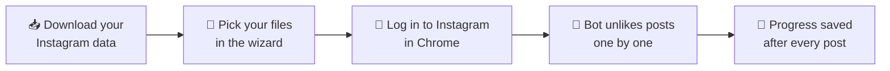

<div align="center">

# 💔 Instagram Mass Unlike Bot

**Remove your likes from thousands of Instagram posts and Reels, using a simple step-by-step desktop wizard.**


[Features](#-features) • [Requirements](#-requirements) • [Quick start](#-quick-start) • [Limitations](#-known-limitations) • [Troubleshooting](#-troubleshooting) • [Developers](#-for-developers) • [License](#-license)

</div>

---

> [!WARNING]
> **Important disclaimer: please read before using this tool.**
>
> **1. AI Usage:** I used AI a lot. By a lot, I mean A LOT. So, if you are uncomfortable with using a tool made mostly by AI, you can skip this.
>
> **2. Rate Limit & Safety:** Instagram restricts automated activity: performing more than roughly 100–150 actions per day may trigger a temporary "Action Block". To reduce that risk, the script waits a random 15–25 seconds between posts and takes a 5-minute break after every 35 successful unlikes. **Please do not reduce these timers.** Even so, **safety is not guaranteed**: automating Instagram may violate its Terms of Use and can lead to temporary restrictions or, in the worst case, a suspended account. By installing and using this tool, you accept that you do so **entirely at your own risk**.
>
> **3. Privacy & Security:** I used completely open-sourced software and even this project is open-sourced. Your JSON files are processed locally on your computer, and `unlike_bot.py` contains no code that sends them anywhere. You log in to Instagram yourself in a regular Chrome window; the app never asks for or stores your password. The progress and log files the app creates stay on your computer next to your likes file; they contain post links from your data, so do not share them. Third-party dependencies such as `undetected-chromedriver` may download a matching ChromeDriver on first run. As with any software, review the source code yourself, and consider building the executable from source instead of trusting a prebuilt binary.

## 📖 About

A desktop wizard that removes your likes from Instagram posts and Reels in bulk. It works from the data export that Instagram lets you download, can optionally protect ("whitelist") users such as the people you follow, and drives a real Chrome window to unlike each post for you.

Ready-made downloads are available for **Windows** (one `.exe`) and **Linux** (a `.deb` package, or a `.tar.gz` for other distributions), so end-users do not need to install Python.



## ✨ Features

| | Feature | Details |
|---|---|---|
| 🧙 | **Step-by-step GUI** | A complete wizard interface built with Tkinter, in English and Turkish (Türkçe). No command line needed. |
| 🛡️ | **Smart whitelist** | Add one or several followers/following files (for example `following.json` and `followers_1.json`). Likes on posts by those users are kept. Users are matched by username, and duplicates between files are counted once. |
| ✅ | **Verified unliking** | After each click, the bot checks that the heart really changed. A post is only marked as done when this is confirmed. If something is unclear, the post stays on your to-do list, and the bot stops after 5 such posts in a row. |
| 💾 | **Safe resume** | Your original export is **never modified**. Progress is stored in a small side file next to it. To continue later, run the tool again and select the same likes file. |
| ⏹️ | **Stop button** | Stops cleanly after the current step. Closing the window while the bot runs asks for confirmation first. |
| 🕵️ | **Undetected Chromedriver** | Uses [undetected-chromedriver](https://github.com/ultrafunkamsterdam/undetected-chromedriver) to reduce the chance of being flagged as automated, and automatically picks the ChromeDriver version that matches your Chrome. **Not guaranteed.** |
| 🖱️ | **Hybrid clicking** | Randomized delays, plus a click via Selenium `ActionChains` with a JavaScript fallback, intended to avoid scroll-snapping issues on Reels. |

## 📋 Requirements

- **Google Chrome** installed on your computer, and an internet connection (the matching ChromeDriver is downloaded on first run).
- **Instagram set to English or Turkish.** The bot finds buttons and reads your data export by their English/Turkish labels, so other languages will not work.
- **Your Instagram data export** (see [below](#-get-your-instagram-data)).
- **A hands-off Chrome window.** The bot controls the Chrome window it opens. Do not click inside it, navigate away, or close it while the bot is running, and keep your computer awake and online.

## 📥 Get your Instagram data

1. On Instagram (app or web), go to `Settings > Accounts Center > Your information and permissions > Download your information`.
2. Select only the **Likes** and **Followers and following** categories, choose **JSON** as the format and **All time** as the date range.
3. Extract the downloaded archive. You will need `liked_posts.json` and, optionally, whitelist files such as `following.json` and `followers_1.json`.

## 🚀 Quick start

Download the file for your system from the [latest release](https://github.com/mehmet-ak/instagram-mass-unlike/releases/latest).

### Windows

Download `InstagramMassUnlike-WindowsGUI.exe` and double-click it. There is nothing to install. Windows may show a SmartScreen warning for unsigned apps; only continue if you downloaded the file from this repository's Releases page.

### Linux (Debian, Ubuntu, Linux Mint)

Download the `.deb` file (`instagram-mass-unlike_<version>_amd64.deb`) and double-click it to install, or run:

```bash
sudo apt install ./instagram-mass-unlike_*_amd64.deb
```

Afterwards, **Instagram Mass Unlike** appears in your application menu with its icon, and can be removed like any other app.

### Linux (other distributions)

Download `InstagramMassUnlike-Linux.tar.gz`, extract it, and run:

```bash
./InstagramMassUnlike-LinuxGUI
```

Optionally, add it to your application menu (with its icon) by running `sh install_linux.sh` from the extracted folder. If the menu still shows no icon, log out and back in once.

### 🧭 The wizard, step by step

| Step | Screen | What to do |
|:---:|---|---|
| 1 | **Language** | Choose English or Türkçe. |
| 2 | **Whitelist** | Choose whether to protect users. If yes, click **Add file(s)** and pick your `following.json` and/or followers files (you can select several at once or add them one by one). Each file is checked right away and shows how many usernames it contains. |
| 3 | **Likes file** | Browse to your `liked_posts.json`. The wizard shows how many likes there are in total, how many are protected, how many were skipped, how many were already done in an earlier run, and how many will be unliked now. |
| 4 | **Login & confirm** | Click **1. Open Chrome & Login** and log in to Instagram in the window that opens. Only after you are fully logged in, return to the app and click **2. Ready! Start Process**. |
| 5 | **Progress** | Watch the progress bar and counters. Click **Stop** at any time. A summary appears when the run ends. |

### ⏳ How long does it take?

With the built-in delays, the bot needs roughly 30 seconds per post, plus a 5-minute break after every 35 successful unlikes. That is about **100 posts per hour** (around 10 hours for 1,000 posts). This is an estimate based on the delays in the code.

This pace is faster than the 100–150 actions per day mentioned in the disclaimer. To be more cautious, process your likes in several shorter sessions: click **Stop**, and continue later by selecting the same likes file again.

### 💾 Files the bot creates

Next to your likes file, the bot creates two small files:

- `liked_posts.progress.jsonl` remembers which posts are finished. Delete it if you want to start over.
- `liked_posts.log` records what happened, which helps when something goes wrong.

Both contain post links from your data, so do not share them. Your original export files are never changed.

## 🚧 Known limitations

- **English and Turkish only.** See the requirements above.
- **Posts and Reels only.** Only the entries in `liked_posts.json` are processed, not liked comments.
- **Unclear posts stay pending.** If the bot cannot confirm a post (you are logged out, the action is blocked, the page loads slowly, or Instagram changed its layout), it does **not** mark it as done. After 5 such posts in a row, it stops and tells you why.
- **Deleted posts are retried.** A post that no longer exists cannot be confirmed, so it stays on the to-do list and is tried again on every run.
- **No direct Action Block detection.** The bot notices a block only indirectly, through the 5-in-a-row rule above.
- **Whitelist and unknown owners.** When a whitelist is used, likes whose owner cannot be read from the export are skipped to be safe, and are counted as "skipped" in the wizard.
- **Pace.** See [How long does it take?](#-how-long-does-it-take).

## 🩺 Troubleshooting

| Problem | What to do |
|---|---|
| *"This version of ChromeDriver only supports Chrome version …"* | This is fixed automatically: the app retries with the ChromeDriver that matches your installed Chrome. It needs an internet connection. If it still fails, update Chrome. |
| The bot stops with *"posts in a row could not be verified"* | Check the Chrome window: you may be logged out, Instagram may ask for a confirmation, or actions may be blocked. Wait a while, then run the tool again with the same likes file. Finished posts are skipped automatically. |
| No icon in the Linux application menu | Log out and back in once. If you used the `.tar.gz`, run `sh install_linux.sh` again from the extracted folder. |
| I want to start over | Delete the `.progress.jsonl` file next to your likes file. |
| Something else went wrong | Look at the `.log` file next to your likes file, or open an issue (remove any personal data from the log first). |

## 🧰 For developers

Run the project from source:

1. Clone the repository and create a virtual environment:
   ```bash
   git clone https://github.com/mehmet-ak/instagram-mass-unlike.git
   cd instagram-mass-unlike
   python3 -m venv bot_env
   ```

   Activate it on Linux:
   ```bash
   source bot_env/bin/activate
   ```

   Or on Windows:
   ```bash
   bot_env\Scripts\activate
   ```

2. On Debian/Ubuntu you may also need Tkinter:
   ```bash
   sudo apt install python3-tk
   ```

3. Install the dependencies:
   ```bash
   pip install -r requirements.txt
   ```

4. Run the app:
   ```bash
   python unlike_bot.py
   ```

### Building the release files

Each build must be run on its target operating system, from the repository root with the virtual environment active. The scripts install [PyInstaller](https://pyinstaller.org) and Pillow for you.

| System | Command | Result in `dist/` |
|---|---|---|
| Windows | `build_windows.bat` | `InstagramMassUnlike-WindowsGUI.exe` (icon embedded) |
| Linux | `sh build_linux.sh 1.1.0` | `instagram-mass-unlike_1.1.0_amd64.deb` and `InstagramMassUnlike-Linux.tar.gz` |

Upload these files to a GitHub Release; users only need to download one of them. The version number only affects the `.deb` file name.

The application icon lives in `assets/`. Run `python assets/make_icon.py` (needs Pillow) to regenerate `icon.png` and `icon.ico`; the build scripts do this automatically if the files are missing.

### Repository layout

| File | Purpose |
|---|---|
| `unlike_bot.py` | The whole application: Tkinter wizard and Selenium automation |
| `requirements.txt` | Python dependencies |
| `assets/` | Application icon and the script that generates it |
| `build_windows.bat` | Builds the Windows `.exe` |
| `build_linux.sh` | Builds the Linux `.deb` and `.tar.gz` |
| `build_deb.sh` | Builds the `.deb` package (called by `build_linux.sh`) |
| `install_linux.sh` | Adds the app to the application menu (shipped in the `.tar.gz`) |
| `LICENSE` | GNU General Public License v3.0 |

## 📄 License

Distributed under the **GNU General Public License v3.0**. See [`LICENSE`](LICENSE) for details. This project builds on [undetected-chromedriver](https://github.com/ultrafunkamsterdam/undetected-chromedriver) (GPL-3.0) and [Selenium](https://www.selenium.dev/).

This project is not affiliated with, endorsed by, or connected to Instagram or Meta.
