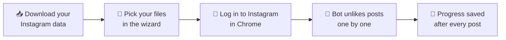

<div align="center">

# 💔 Instagram Mass Unlike Bot

**Remove your likes from thousands of Instagram posts and Reels, using a simple step-by-step desktop wizard.**


[Features](#-features) • [Requirements](#-requirements) • [Quick start](#-quick-start) • [Limitations](#-known-limitations) • [Developers](#-for-developers) • [License](#-license)

</div>

---

> [!WARNING]
> **Important disclaimer: please read before using this tool.**
>
> **1. AI Usage:** I used AI a lot. By a lot, I mean A LOT. So, if you are uncomfortable with using a tool made mostly by AI, you can skip this.
>
> **2. Rate Limit & Safety:** Instagram restricts automated activity: performing more than roughly 100–150 actions per day may trigger a temporary "Action Block". To reduce that risk, the script waits a random 15–25 seconds between posts and takes a 5-minute break after every 35 successful unlikes. **Please do not reduce these timers.** Even so, **safety is not guaranteed**: automating Instagram may violate its Terms of Use and can lead to temporary restrictions or, in the worst case, a suspended account. By installing and using this tool, you accept that you do so **entirely at your own risk**.
>
> **3. Privacy & Security:** I used completely open-sourced software and even this project is open-sourced. Your JSON files are processed locally on your computer, and `unlike_bot.py` contains no code that sends them anywhere. You log in to Instagram yourself in a regular Chrome window; the app never asks for or stores your password. Third-party dependencies such as `undetected-chromedriver` may download a matching ChromeDriver on first run. As with any software, review the source code yourself, and consider building the executable from source instead of trusting a prebuilt binary.

## 📖 About

A desktop wizard that removes your likes from Instagram posts and Reels in bulk. It works from the data export that Instagram lets you download, can optionally protect ("whitelist") users such as the people you follow, and drives a real Chrome window to unlike each post for you.

Standalone executables for **Windows** (`.exe`) and **Linux** are provided, so end-users do not need to install Python.



## ✨ Features

| | Feature | Details |
|---|---|---|
| 🧙 | **Step-by-step GUI** | A complete wizard interface built with Tkinter. No command line needed. |
| 🛡️ | **Smart whitelist** | Select your `following.json` (or any followers list) to skip likes on posts by those users. Users are matched by username. |
| 💾 | **Auto-save & resume** | After each processed post, its entry is removed from the `liked_posts.json` you selected. To continue later, run the tool again and select the same file. |
| 🕵️ | **Undetected Chromedriver** | Uses [undetected-chromedriver](https://github.com/ultrafunkamsterdam/undetected-chromedriver) to reduce the chance of being flagged as automated. **Not guaranteed.** |
| 🖱️ | **Hybrid clicking** | Randomized delays, plus a click via Selenium `ActionChains` with a JavaScript fallback, intended to avoid scroll-snapping issues on Reels. |
| 🌐 | **Multi-language wizard** | The setup wizard supports English and Turkish (Türkçe). |

## 📋 Requirements

- **Google Chrome** installed on your computer.
- **Instagram set to English or Turkish.** The bot finds buttons and reads your data export by their English/Turkish labels, so other languages will not work.
- **Your Instagram data export** (see [below](#-get-your-instagram-data)).
- **A hands-off Chrome window.** The bot controls the Chrome window it opens. Do not click inside it, navigate away, or close it while the bot is running, and keep your computer awake and online.

> [!IMPORTANT]
> The tool **modifies the `liked_posts.json` file you select** (finished posts are removed from it). **Make a backup copy before you start.**

## 📥 Get your Instagram data

1. On Instagram (app or web), go to `Settings > Accounts Center > Your information and permissions > Download your information`.
2. Select only the **Likes** and **Followers and following** categories, choose **JSON** as the format and **All time** as the date range.
3. Extract the downloaded archive. You will need `liked_posts.json` and, optionally, a whitelist file such as `following.json` or `followers_1.json`.
4. Copy `liked_posts.json` somewhere safe as a backup.

## 🚀 Quick start

### Windows

1. Download `Windows-Release.zip` from the [Releases](https://github.com/mehmet-ak/instagram-mass-unlike/releases/tag/v1.0.0) page and extract it.
2. Double-click the `.exe` file. Windows may show a SmartScreen warning for unsigned apps; only continue if you downloaded it from this repository's Releases page.
3. Follow the wizard (see [below](#-the-wizard-step-by-step)).

### Linux

1. Download `Linux-Release.zip` from the [Releases](https://github.com/mehmet-ak/instagram-mass-unlike/releases/tag/v1.0.0) page and extract it.
2. Make the file executable:
   ```bash
   chmod +x InstagramMassUnlike-LinuxGUI
   ```
3. Run it:
   ```bash
   ./InstagramMassUnlike-LinuxGUI
   ```
4. Follow the wizard (see below).

### 🧭 The wizard, step by step

| Step | Screen | What to do |
|:---:|---|---|
| 1 | **Language** | Choose English or Türkçe. |
| 2 | **Whitelist** | Choose whether to protect users. If yes, browse to your `following.json` (or other followers file). |
| 3 | **Likes file** | Browse to your `liked_posts.json`. The wizard shows how many likes there are in total, how many are protected, and how many will be unliked. |
| 4 | **Login & confirm** | Click **1. Open Chrome & Login** and log in to Instagram in the window that opens. Only after you are fully logged in, return to the app and click **2. Ready! Start Process**. |
| 5 | **Progress** | Watch the progress bar and status line. A message appears when everything is done. |

### ⏳ How long does it take?

With the built-in delays, the bot needs roughly 30 seconds per post, plus a 5-minute break after every 35 successful unlikes. That is about **100 posts per hour** (around 10 hours for 1,000 posts). This is an estimate based on the delays in the code.

This pace is faster than the 100–150 actions per day mentioned in the disclaimer. To be more cautious, process your likes in several shorter sessions: progress is saved after every post, so you can close the app while the status line shows *"Waiting … seconds"* and continue later with the same file.

## 🚧 Known limitations

- **Missing Unlike button = "already unliked".** If the bot cannot find the Unlike button within about 5 seconds (for example because you are logged out, the action is blocked, the page loads slowly, or the post was deleted), it treats the post as already unliked and removes it from your file. The bot does **not** detect Action Blocks or rate limits, so after a block, posts can be marked as done without actually being unliked. Watch the first posts, and stop if the likes are not being removed.
- **Errors are retried.** If an unexpected error occurs while processing a post, that post stays in the file and is retried on the next run.
- **Posts without readable owner data are skipped.** Likes whose URL or owner username cannot be read from the export are not targeted, and count as "protected" in the wizard statistics.
- **Posts and Reels only.** Only the entries in `liked_posts.json` are processed.
- **Original file is overwritten.** See the backup note above.

## 🧰 For developers

Run the project from source:

1. Clone the repository and create a virtual environment:
   ```bash
   git clone https://github.com/mehmet-ak/instagram-mass-unlike.git
   cd instagram-mass-unlike
   python3 -m venv bot_env
   ```

   Activate it on Linux:
   ```bash
   source bot_env/bin/activate
   ```

   Or on Windows:
   ```bash
   bot_env\Scripts\activate
   ```

2. On Debian/Ubuntu you may also need Tkinter:
   ```bash
   sudo apt install python3-tk
   ```

3. Install the dependencies:
   ```bash
   pip install -r requirements.txt
   ```

4. Run the app:
   ```bash
   python unlike_bot.py
   ```

Build a standalone executable with [PyInstaller](https://pyinstaller.org). Each build must be run on its target operating system:

```bash
pip install pyinstaller
```

Windows (run on a Windows machine):
```bash
pyinstaller --onefile --noconsole --name InstagramMassUnlike-WindowsGUI unlike_bot.py
```

Linux (run on a Linux machine):
```bash
pyinstaller --onefile --windowed --name InstagramMassUnlike-LinuxGUI unlike_bot.py
```

| File | Purpose |
|---|---|
| `unlike_bot.py` | The whole application: Tkinter wizard and Selenium automation |
| `requirements.txt` | Python dependencies |
| `LICENSE` | GNU General Public License v3.0 |

## 📄 License

Distributed under the **GNU General Public License v3.0**. See [`LICENSE`](LICENSE) for details. This project builds on [undetected-chromedriver](https://github.com/ultrafunkamsterdam/undetected-chromedriver) (GPL-3.0) and [Selenium](https://www.selenium.dev/).

This project is not affiliated with, endorsed by, or connected to Instagram or Meta.
